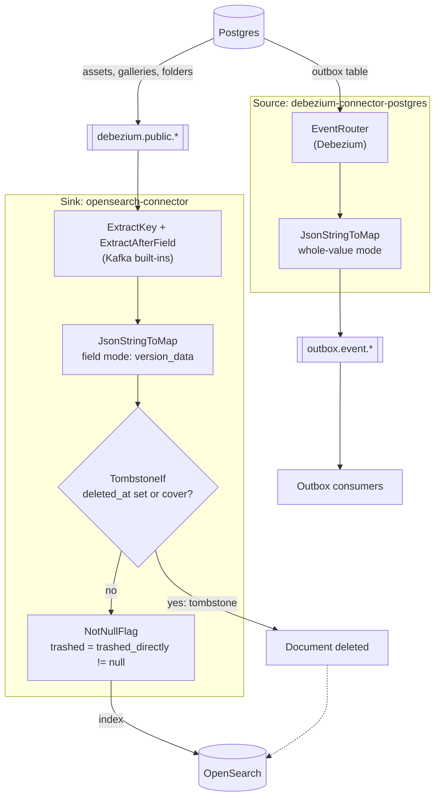

# picflow-kafka-connect-transforms

Custom Kafka Connect **Single Message Transforms (SMTs)** used by the Picflow source and sink connectors. An SMT changes each record as it passes through a connector, before it is written to Kafka (source) or to the target system (sink). All transforms ship in one jar, which the Kafka Connect cluster in `picflow-backend` loads as a plugin.

| Transform | What it does |
| --- | --- |
| `com.picflow.transforms.JsonStringToMap$Value` | Parses a JSON string field (e.g. `version_data`), or the whole value, into a nested map |
| `com.picflow.transforms.NotNullFlag$Value` | Sets a boolean field to whether another field is non-null (e.g. `trashed = trashed_directly != null`) |
| `com.picflow.transforms.TombstoneIf$Value` | Turns a record into a delete if any rule matches (e.g. `deleted_at != null` or `cover == true`) |

## How it works



Both connectors run in the same Kafka Connect cluster and use `JsonConverter` with `schemas.enable=false`, so records are plain JSON without an embedded schema.

- **Source, outbox events.** Debezium captures the `outbox` table. `EventRouter` routes each row to `outbox.event.<type>` and keeps `payload` as a JSON string. `JsonStringToMap` without `field.name` parses that string into a map, so consumers receive the payload as a JSON object. The payload is parsed here rather than by `EventRouter`, because `EventRouter` infers a Connect schema from it and fails on arrays with mixed number types such as `[0.5, 0]`.
- **Sink, search index.** Debezium change events for assets, galleries and folders flow to OpenSearch. The built-in transforms take the row `id` as the document id and the `after` state as the document. The Picflow transforms only run on `debezium.public.assets` (through the `isAssetsTopic` predicate): `JsonStringToMap` parses `version_data`; `TombstoneIf` turns soft-deleted assets and covers into tombstones, which the sink handles as deletes (`behavior.on.null.values=delete`); `NotNullFlag` sets `trashed` so search can filter on `trashed: false`.

`opensearch-connector-rebuild` runs the same chain on the `debezium.rebuild.*` topics to rebuild the index from scratch.

## JsonStringToMap

Parses JSON stored as a string into a map. It works in one of two modes, depending on `field.name`:

- **Field mode** (`field.name` set): the value must be a schemaless map; the named string field is replaced with the parsed map and the value schema is kept. Records whose value is not a map, or whose field is not a string, pass through unchanged. Includes legacy fixes for `version_data.data`:
  - `"60000/1001"` in `frame_rate` → `59.94` (float)
  - `"N/A"` in `frame_count` → `0`
- **Whole-value mode** (`field.name` unset): the whole value must be a JSON string; it is replaced with the parsed map and the value schema is dropped. Records whose value is not a string pass through unchanged.

Invalid JSON is logged and the record passes through unchanged.

| Config | Description |
| --- | --- |
| `field.name` | Field containing the JSON string. Optional; when unset, the whole value is parsed |

Whole-value mode emits schemaless data, so use it with `JsonConverter` and `schemas.enable=false`. The converter then writes plain JSON without inferring a Connect schema, which avoids schema inference failures such as mixed number types in one array (`[0.5, 0]`). Integers larger than `long` are not supported in this mode: schemaless `JsonConverter` cannot serialize them and fails the task.

## NotNullFlag

Sets `target.field` to `true` if `source.field` is non-null, `false` if it is null. Records without `source.field` (and tombstones) pass through unchanged.

| Config | Description |
| --- | --- |
| `source.field` | Field whose null-ness is checked |
| `target.field` | Boolean field to set |

## TombstoneIf

Turns the record into a tombstone (key kept, value and value schema null) if any field in `if.not.null` is non-null or any field in `if.true` is `true`. With `behavior.on.null.values=delete` on the sink, the document is deleted. A field missing from the value never matches; tombstones pass through unchanged.

Only use it for states that never revert: a document deleted here comes back only with the fields of the next Postgres change, without what other processors wrote into it.

| Config | Description |
| --- | --- |
| `if.not.null` | Comma-separated fields; the record becomes a tombstone if any is non-null |
| `if.true` | Comma-separated boolean fields; the record becomes a tombstone if any is `true` |

At least one of the two must be set.

## Configuration in picflow-backend

The connector configs live in `picflow-backend` under `kustomization/components/kafka-connectors/`. Transforms run in the order listed in `transforms`.

OpenSearch sink (`opensearch-connector`):

```properties
behavior.on.null.values=delete

transforms=ExtractKey,ExtractAfterField,JsonStringToMapTransform,DeleteRemoved,TrashedFlag

transforms.ExtractKey.type=org.apache.kafka.connect.transforms.ExtractField$Key
transforms.ExtractKey.field=id

transforms.ExtractAfterField.type=org.apache.kafka.connect.transforms.ExtractField$Value
transforms.ExtractAfterField.field=after

transforms.JsonStringToMapTransform.type=com.picflow.transforms.JsonStringToMap$Value
transforms.JsonStringToMapTransform.field.name=version_data
transforms.JsonStringToMapTransform.predicate=isAssetsTopic

transforms.DeleteRemoved.type=com.picflow.transforms.TombstoneIf$Value
transforms.DeleteRemoved.if.not.null=deleted_at
transforms.DeleteRemoved.if.true=cover
transforms.DeleteRemoved.predicate=isAssetsTopic

transforms.TrashedFlag.type=com.picflow.transforms.NotNullFlag$Value
transforms.TrashedFlag.source.field=trashed_directly
transforms.TrashedFlag.target.field=trashed
transforms.TrashedFlag.predicate=isAssetsTopic

predicates=isAssetsTopic
predicates.isAssetsTopic.type=org.apache.kafka.connect.transforms.predicates.TopicNameMatches
predicates.isAssetsTopic.pattern=debezium.public.assets
```

Debezium source (`debezium-connector-postgres`), outbox part:

```properties
value.converter=org.apache.kafka.connect.json.JsonConverter
value.converter.schemas.enable=false

transforms=outbox,outboxJson
transforms.outbox.type=io.debezium.transforms.outbox.EventRouter
transforms.outbox.predicate=isOutbox
transforms.outboxJson.type=com.picflow.transforms.JsonStringToMap$Value
transforms.outboxJson.predicate=isOutboxEvent

predicates=isOutbox,isOutboxEvent
predicates.isOutbox.type=org.apache.kafka.connect.transforms.predicates.TopicNameMatches
predicates.isOutbox.pattern=debezium\.public\.outbox
predicates.isOutboxEvent.type=org.apache.kafka.connect.transforms.predicates.TopicNameMatches
predicates.isOutboxEvent.pattern=outbox\.event\..*
```

`outboxJson` matches on `outbox.event.*` because `EventRouter` has already moved the record to its target topic when `outboxJson` runs.

## Adding a transform

1. Add a class implementing `org.apache.kafka.connect.transforms.Transformation` under `src/main/java/com/picflow/transforms/`, with a nested `Value` class.
2. Register the `Value` class in `src/main/resources/META-INF/services/org.apache.kafka.connect.transforms.Transformation`; Kafka Connect doesn't find it otherwise.
3. Add a test under `src/test/java`.

## Build and release

```
mvn clean package
```

Without a local JDK:

```
docker run --rm -v "$PWD":/src -v "$HOME/.m2":/root/.m2 -w /src maven:3.9-eclipse-temurin-17 mvn -B clean package
```

CI (`.github/workflows/test.yml`) runs `mvn test` on pull requests. It does not rebuild the committed jar.

Kafka Connect loads the jar from the GitHub archive of a tag (`picflow-backend`, `kustomization/components/kafka-connect/kafka-connect-cluster.yaml`), so the built jar in `target/` is committed. To release:

1. Bump `version` in `pom.xml` to a version no other branch uses, build, and commit the new jar (replacing the previous one in `target/`) in the same PR.
2. After merging, tag the merge commit with the version (e.g. `0.6.0`) and create a GitHub release for it.
3. In `picflow-backend`, point the plugin URL in `kafka-connect-cluster.yaml` at the new tag. Each tag contains every transform, so moving to a newer tag doesn't affect connectors that use older transforms.
